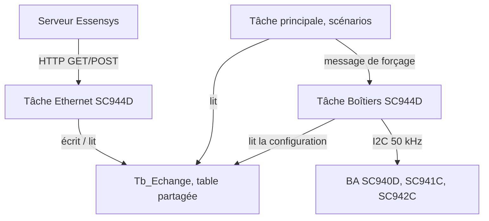
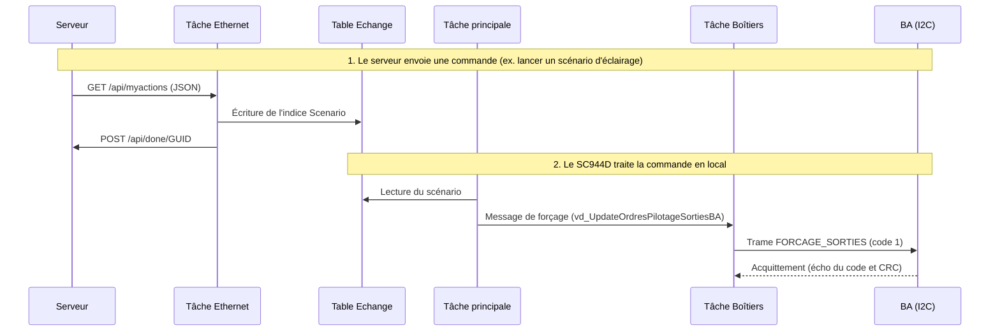

# 💻 Documentation Firmware

Le firmware du module SC944D est basé sur le RTOS **MQX** et tourne sur un microcontrôleur **ColdFire MCF52259**.

!!! danger "Ne jamais reflasher le BP avec un nouveau build"
    En production, le BP ne reçoit que l'image **099-37** (`.S19` de `SC944D/Prog/099-37/`), sauvegarde BDM faite au préalable. Aucun build issu des sources actuelles n'est flashé, ni par BDM ni par téléchargement depuis le serveur, tant que le pilote I2C n'est pas reconstitué et qualifié sur banc. Voir [Programmation du BP et retour arrière](#programmation-du-bp-et-retour-arriere).

## Environnement de Développement

*   **IDE** : CodeWarrior for ColdFire.
*   **OS** : MQX RTOS.
*   **Langage** : C.
*   **Programmation** : sonde BDM P&E Multilink Universal ; les configurations de lancement `*_PEBDM.launch` sont fournies avec le projet.

## Structure du Projet

Les sources de la version 099-37 sont dans `SC944D/Prog/099-37/BP_MQX_ETH`. Elles correspondent à celles du dépôt `client-essensys-legacy`. Le BSP MQX de production n'y figure pas (voir plus bas).

*   `C/` : Sources (.c) dont `main.c`, `ba.c`, `ba_i2c.c`.
*   `Ethernet/` : dialogue avec le serveur (`www.c`, `Json.c`).
*   `H/` : Headers (.h) dont `Hard.h`, `TableEchange.h`, `global.h`, `application.h`.

## Algorithmes Principaux

### 1. Démarrage du Client (`main.c`)

Au reset, la tâche **Main_task** exécute la séquence suivante :

1.  **Initialisation Hardware** : Appel de `vd_InitHard()` (configuration des I/O, PWM, ADC).
2.  **Lecture Configuration (EEPROM)** :
    *   Ouverture du port SPI (`vd_SpiOpen`).
    *   Lecture de l'adresse MAC.
    *   Lecture de la **Clé Serveur** (chiffrée).
    *   Lecture du **Code Alarme**.
3.  **Initialisation Applicative** :
    *   Initialisation des modules : Chauffage (`vd_Chauffage`), Alarme (`vd_AlarmeInit`), Timers.
4.  **Démarrage des Tâches** :
    *   `vd_StartTacheEcran()` : IHM locale.
    *   `vd_StartTacheBA()` : Communication I2C avec les cartes filles.
    *   `vd_StartTacheTeleinfo()` : Lecture compteur Linky.
    *   `vd_StartTacheEthernet()` : Connexion serveur.
5.  **Boucle Principale** : Surveillance alimentation et batterie (Watchdog soft).

### 2. Communication avec les boîtiers auxiliaires (SC940D, SC941C, SC942C)

Le SC944D est **maître I2C** des trois boîtiers auxiliaires (BA). Deux éléments gèrent ce dialogue :

- la tâche `Boitiers_task` (`C/ba.c`), nommée « I2C » dans MQX, de priorité 8 avec une tranche de temps de 50 ms ;
- la fonction de transaction `sl_fct_write_polled()` (`C/ba_i2c.c`).

Le protocole complet est décrit dans [Protocoles I2C](i2c.md). En résumé :

*   **Bus.** Le bus tourne à **50 kHz**. Les BA répondent aux adresses **0x11** (SC940D), **0x12** (SC942C) et **0x13** (SC941C).
*   **Envoi sur changement.** La tâche boucle en continu et n'envoie une trame que lorsqu'une valeur change. Chaque transaction écrit la trame, puis lit 5 octets d'acquittement : l'écho du code et les CRC. Elle est suivie d'une pause de 100 ms.
*   **Types de trame.** Il y en a cinq :
    *   `uc_TRAME_BA_FORCAGE_SORTIES` (code 1) : ordres d'allumage, d'extinction, d'ouverture et de fermeture ;
    *   `uc_TRAME_BA_CONF_SORTIES` (2), `uc_TRAME_BA_TPS_EXTINCTION` (3) et `uc_TRAME_BA_TPS_ACTION` (4) : configuration ;
    *   `uc_TRAME_BA_ACTIONS` (5) : seulement trois indicateurs, `Secouru`, `BloqueVolets` et `ForceAllumage`.
*   **Acquittement.** Il prouve que la trame est arrivée intacte. Il ne remonte aucun état d'entrée ni de sortie.

**Interaction avec le serveur.** L'architecture est **découplée** : aucune trame I2C n'appelle le serveur.

1.  La tâche Ethernet (`ETH_TASK`) reçoit les ordres du serveur et les écrit dans la table partagée `Tb_Echange`. Un scénario est écrit dans l'indice `Scenario`.
2.  La tâche principale exécute le scénario (`C/Scenario.c`) et prépare les ordres de pilotage dans `us_Tb_Echangeboitier`. `vd_UpdateOrdresPilotageSortiesBA()` les transmet ensuite à la tâche Boîtiers par un message.
3.  La tâche Boîtiers envoie la trame FORCAGE_SORTIES au BA concerné. Si une configuration a changé dans `Tb_Echange`, elle envoie aussi les trames 2 à 4.
4.  Les défauts de communication des BA sont reportés dans l'index 12 (`Information`, `comm_faults` côté serveur). Le BP le transmet quand le serveur le demande (`POST /api/mystatus`).

#### Diagrammes de Séquence

**Architecture Globale**



**Flux de Données : Serveur vers Action Hardware**



L'acquittement `POST /api/done/{GUID}` est envoyé dès l'écriture dans `Tb_Echange`. Il ne garantit pas que le BA a appliqué l'ordre.

#### Format de la Trame ACTIONS

| Octet | Description |
| :--- | :--- |
| 0 | Code Commande (`uc_TRAME_BA_ACTIONS` = 5) |
| 1 | Indicateurs `Secouru`, `BloqueVolets`, `ForceAllumage` |
| 2 | CRC-16 (Poids faible) |
| 3 | CRC-16 (Poids fort) |

Les autres trames (codes 1 à 4) portent 8 ou 16 octets de données : voir [Protocoles I2C](i2c.md#codes-de-trame).

### 3. Connexion Serveur et Mise à Jour Firmware

La tâche Ethernet (`Ethernet/www.c`) gère la machine d'état réseau :

1.  **Connexion Réseau** : Vérification lien physique, obtention IP (DHCP ou Fixe), Résolution DNS de `mon.essensys.fr`.
2.  **Dialogue Serveur (`sc_DialogueAvecServeur`)** :
    *   **GET /api/serverinfos** (`sc_GetInformationServer`) :
        *   Récupère l'état de la connexion (`isconnected`), la présence d'une nouvelle version (`newversion`).
        *   **Demande d'informations** (`infos`): Le serveur fournit une liste d'ID (Table Echange) dont il souhaite connaître la valeur actuelle.
            *   *Capacité* : Le serveur peut demander jusqu'à **30 ID** simultanément (`uc_NB_MAX_INFOS_DEMANDEES_PAR_SERVEUR`).
            *   *Usage* : Cela permet au serveur de récupérer l'état de n'importe quelle variable du système (ex: `Variateurs_PDV_Conf` pour l'éclairage, `Scenario`, `Températures`, etc.).
            *   *Lumières* : Le serveur peut donc savoir quelles lumières sont allumées ou éteintes en lisant les registres correspondants. **Attention**, il s'agit de l'état "commandé" (mémoire du SC944D) et non d'un retour d'état physique du relais (pas de feedback matériel d'intensité dans le protocole I2C actuel).
    *   **POST /api/mystatus** (`sc_PostInformationServer`) : Envoie les valeurs demandées précédemment au format JSON `{k:ID, v:Valeur}`.
    *   **GET /api/myactions** (`sc_ActionManagment`) : Récupère les actions à exécuter (ex: pilotage relais, `Scenario_Allumer_PDV_LSB`).
3.  **Téléchargement Firmware (`sc_Download`)** :
    *   Si `newversion` != 0 dans la réponse serveur :
        *   Le système passe en mode "Download" (suspend I2C).
        *   Télécharge le binaire S19 via HTTP.
        *   Le stocke en Flash (zone réservée).
        *   Vérifie le CRC.
        *   Sauvegarde la `TableEchange` en Flash.
        *   **Reboot** (`vd_MCF52259_REBOOT`) pour appliquer la mise à jour (Bootloader).

!!! warning "Téléchargement depuis le serveur"
    Le BP installe tout binaire que le serveur lui annonce par `newversion`. Côté serveur, aucune nouvelle version ne doit donc être annoncée à un BP en service tant que la condition de la section [Programmation du BP et retour arrière](#programmation-du-bp-et-retour-arriere) n'est pas remplie.

### 4. Mise à jour Table de Référence et Statuts

Le système repose sur une table centrale **`Tb_Echange`** (`TableEchange.h`) qui contient tout l'état du système.

*   **Réception des Actions (Server -> SC944D)** :
    *   La fonction `sc_TraiterActions` reçoit un JSON du serveur (GUID + Paramètres).
    *   Elle parse les paires `(Index, Valeur)`.
    *   Elle met à jour `Tb_Echange` via `uc_TableEchange_Ecrit_Data(Index, Valeur)`.
    *   *Cas particulier* : Les scénarios sont appliqués en dernier pour garantir que tous les paramètres sont prêts.
    *   Acquittement : Envoi d'un `POST /api/done/{GUID}` au serveur.

*   **Envoi des Statuts (SC944D -> Server)** :
    *   Lors du `GET /api/serverinfos`, le serveur fournit une liste d'ID de données qu'il souhaite connaître (`infos: [10, 24, ...]`).
    *   Le SC944D répond via `POST /api/mystatus` en lisant ces ID dans `Tb_Echange` (`uc_TableEchange_Lit_Data`) et en construisant un JSON `{k:ID, v:Valeur}`.

## Programmation du BP et retour arrière

### Seule image autorisée : 099-37

Le BP en service ne reçoit que l'image de production :

```text
SC944D/Prog/099-37/BP_MQX_ETH 20170116 save 099-37.elf_BOOT_CRC.S19
```

**Pourquoi aucun nouveau build.**

- Le BSP I2C de production, qui bornait les attentes du contrôleur I2C, est **perdu**.
- Un build fait depuis les sources actuelles, avec le BSP disponible, réintroduit **cinq boucles d'attente infinies** dans le pilote I2C.
- Au premier défaut de bus (BA non alimenté, ligne tenue basse, perturbation), la tâche I2C se figerait, sans aucune reprise possible.
- Le firmware 099-37, lui, détecte ces blocages et réinitialise le pilote.

**Condition de levée.** L'interdiction vaut jusqu'à ce que quatre étapes soient franchies, dans cet ordre :

1. le pilote I2C MQX est reconstitué dans `essensys-gcc`, avec des attentes bornées en temps ;
2. ce pilote passe sur banc les tests de non-régression `NR-board-sc944d-3` (attentes bornées), `-4` (récupération de bus) et `-12` (endurance 72 h) ;
3. un build candidat est qualifié sur banc avec toute la suite `NR-board-sc944d-*`, y compris la compatibilité croisée avec les BA 1.7 et 1.8 et la non-régression des échanges HTTP ;
4. il est déployé sur un premier BP en service, comme opération de maintenance, après sauvegarde BDM.

Le détail est dans le change OpenSpec [`i2c-surge-protection-2026-10-007`](https://github.com/essensys-hub/essensys-board-SC944D/tree/main/openspec/changes/i2c-surge-protection-2026-10-007) (`design.md`, décision D8 et plan de migration).

Cette règle couvre les deux voies de programmation :

- la programmation par BDM ;
- le téléchargement depuis le serveur (`newversion`, section 3).

### Sauvegarde BDM préalable

Avant **toute** programmation du BP et avant toute retouche lourde de la carte :

1. Lire par BDM la flash interne complète du MCF52259, soit 512 Kio.
2. Archiver le fichier, puis le relire et vérifier son empreinte (sha256).
3. Comparer la sauvegarde au `.S19` 099-37. Documenter l'identité ou l'écart.

!!! warning "La procédure de programmation efface toute la flash"
    La procédure de programmation (`SC944D/Prog/Fiche programmation SC944 v2.docx`) commence par un **« Erase Whole Device »**. La sauvegarde doit donc être faite et vérifiée **avant** de lancer le programmateur de flash de CodeWarrior.

**Limite de la sauvegarde.** Elle ne couvre que la flash interne. La flash SPI externe et l'EEPROM SPI, qui contient l'adresse MAC, la clé serveur et le code d'alarme, sont sauvegardées à part si nécessaire. L'outil [`essensys-bdm-programmer`](https://github.com/essensys-hub/essensys-bdm-programmer) en cours de développement impose ces contrôles par construction.

**Retour arrière.** Reflasher le `.S19` 099-37 par BDM.

### Boîtiers auxiliaires

- **Programmation.** Le PIC d'un BA se programme par ICSP, uniquement avec le `.hex` v1.7 **de son type**, après lecture de son EEPROM. L'adresse I2C (0x11, 0x12 ou 0x13) est compilée dans ce fichier.
- **Build `essensys-gcc` actuel exclu.** Ne jamais flasher un BA avec le build actuel de `essensys-gcc` : ses trois macros `TYPE_*` y sont définies ensemble, ce qui confond les trois types.
- **Firmware v1.8.** Il ajoute un chien de garde, le traitement des erreurs SSP et un octet d'état. Il sera publié avec un `.hex` par type, et reste compatible avec le BP 099-37.

## Variante « retouche foudre » et firmware

La variante « retouche foudre » ([Hardware](hardware.md#variante-retouche-foudre), [note de schéma](retouche-foudre.md)) ne demande **aucune modification de firmware** :

- un BP retouché garde l'image 099-37 ;
- un BA retouché garde son firmware v1.7.

Le protocole et les adresses ne changent pas ; seuls les niveaux logiques du bus sont vérifiés après chaque retouche.

Les limites du firmware 099-37 restent valables sur une carte retouchée (voir [Protections, récupération et resynchronisation](i2c.md#protections-recuperation-et-resynchronisation)) :

- pas de récupération de bus ;
- abandon des commandes marquées acquittées ;
- configurations non renvoyées ;
- index 12 mis à jour seulement après une commande.

Après une panne ou une réparation, **renvoyer les configurations de tous les BA**.

## Mapping Mémoire

Le projet utilise :
*   **Flash Interne** : Code et constantes.
*   **MRAM/EEPROM** : Sauvegarde des paramètres (Mac Address, Soft Params, etc.).
