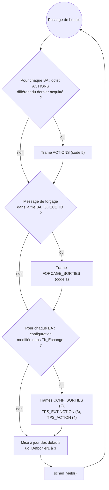
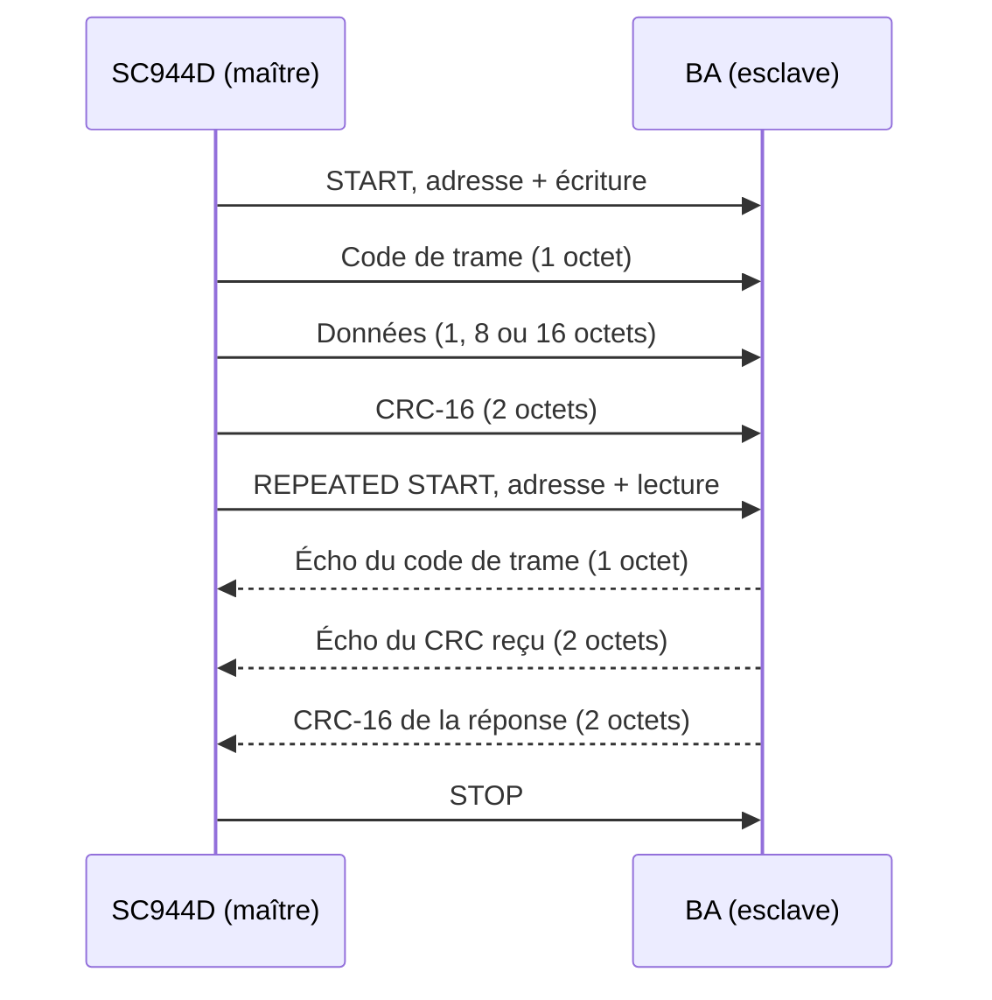

# 📡 Protocole I2C (BP ↔ BA)

Cette page décrit la liaison I2C entre le boîtier principal **SC944D** (BP, maître) et les trois boîtiers auxiliaires (BA, esclaves) : **SC940D**, **SC942C** et **SC941C**.

Elle décrit le firmware de production du BP **099-37** et le firmware des BA **v1.7**. Les sources du BP se trouvent dans `SC944D/Prog/099-37/BP_MQX_ETH` ; elles correspondent à celles du dépôt `client-essensys-legacy`, dont seuls l'encodage et quelques commentaires diffèrent. Les sources des BA se trouvent dans les dépôts `essensys-board-SC940`, `-SC941C` et `-SC942C`, dossier `Prog/code_ba (fichiers sources 1.7)`. Les références de code sont données sous la forme `fichier:ligne`.

!!! note "Corrections d'octobre 2026"
    Cette page a été corrigée dans le cadre du change OpenSpec `i2c-surge-protection-2026-10-007` (ticket [#1](https://github.com/essensys-hub/essensys-board-SC944D/issues/1)) :

    - le bus tourne à **50 kHz**, et non à 100 kHz ;
    - le code de la trame ACTIONS vaut **5**, et non 1 ;
    - les BA répondent aux adresses **0x11 à 0x13** ;
    - les commandes d'éclairage et de volets passent par la trame **FORCAGE_SORTIES**, et non par la trame ACTIONS.

## Architecture physique

| Élément | Valeur | Source |
| :--- | :--- | :--- |
| Contrôleur | I2C0 du MCF52259, pilote MQX en mode interrogé (`"i2c0:"`) | `H/application.h:3` |
| Vitesse | **50 kHz** (`IO_IOCTL_I2C_SET_BAUD` avec 50000) | `C/ba.c:88`, `C/ba_i2c.c:106` |
| Adresse de station du BP | 0x10 | `H/application.h:8` |
| Adresses des BA | 0x11 + numéro du BA, soit **0x11, 0x12 et 0x13** | `H/application.h:9-11`, `C/ba_i2c.c:178` |
| Connecteur du BP | J31, connecteur unique du bus : 1 SDA, 2 SCL, 3 0 V, 4 BA_ALIM (+15 V) | Schéma, page « Liaison boîtiers auxiliaires » |
| Connecteurs des BA | J1 et J2 câblés en parallèle, même brochage que J31 : les BA sont chaînés | Schémas des BA |
| Niveaux | MCF52259 en 3,3 V ; U19 (PCA9306) translate vers 5 V côté bus | Schéma |

| N° de BA (firmware BP) | Constante | Adresse | Carte | Bit de l'index 12 |
| :--- | :--- | :--- | :--- | :--- |
| 0 | `uc_BOITIER_PIECES_VIE` | 0x11 | SC940D (pièces de vie) | 0x04 |
| 1 | `uc_BOITIER_CHAMBRES` | 0x12 | SC942C (chambres) | 0x08 |
| 2 | `uc_BOITIER_PIECES_EAU` | 0x13 | SC941C (pièces d'eau) | 0x10 |

- **Adresse d'un BA.** Elle est fixée à la compilation du firmware BA (`I2C_ADDR` dans `hard.h`, selon la macro `TYPE_*` choisie). Un BA programmé avec le fichier d'un autre type répond donc à la mauvaise adresse : chaque BA ne reçoit que le `.hex` de son type.
- **Variateurs SC943.** Ce sont des cartes filles des BA. Ils ne sont pas adressés sur ce bus.
- **Caractéristiques électriques**, déduites des schémas et des BOM :
    - pull-ups : 1 kΩ côté bus du BP (R155/R156) en parallèle avec 10 kΩ sur chaque BA, soit environ 769 Ω ;
    - capacité de 2 à 3 nF par ligne, fixée par les quatre TVS SMF5V0A de chaque ligne et non par le câble ;
    - temps de montée de 0 à 3,45 V : 1,4 à 3,2 µs.

    Le détail des composants est dans [Hardware](hardware.md#interface-du-bus-des-boitiers-auxiliaires-j31).

## Tâche de dialogue du BP (`Boitiers_task`)

La tâche `Boitiers_task` (`C/ba.c`) dialogue avec les BA. Elle s'appuie sur la fonction de transaction `sl_fct_write_polled()` (`C/ba_i2c.c`).

- **Ordonnancement.** La tâche a la priorité 8 et une tranche de temps de 50 ms (`MQX_TIME_SLICE_TASK`, `C/main.c:71`). Elle boucle en continu (`for(;;)`, puis `_sched_yield()`) : les 50 ms sont une tranche de temps, pas une période.
- **Pause après chaque transaction.** Chaque transaction est suivie d'une pause de 100 ms (`_time_delay(100)`, `C/ba_i2c.c:508`), même en cas d'erreur, pour laisser au BA le temps de traiter la trame. Le bus porte donc au plus une trame toutes les 100 ms environ, tous BA confondus.
- **Accès exclusif.** Chaque transaction est protégée par le sémaphore `lock_I2C`.
- **Téléchargement.** Aucun dialogue n'a lieu pendant un téléchargement de firmware (`uc_DownloadEnCoursBloquerI2CVersBA`).

### Ordre de traitement : envoi sur changement

Le BP n'envoie une trame que lorsqu'une valeur change. À chaque passage de boucle, il traite dans cet ordre :

1. **ACTIONS** (`C/ba.c:157-212`). L'octet commandé est comparé à l'octet acquitté (`Tb_Actions_Cde_BA` et `Tb_Actions_Ack_BA`). Il porte trois indicateurs :
    - `Secouru` : mode secouru ou redémarrage programmé du BP ; le BA sauvegarde alors son état ;
    - `BloqueVolets` : blocage des volets ;
    - `ForceAllumage` : allumage forcé, par exemple en cas d'alarme.
2. **FORCAGE_SORTIES** (`C/ba.c:214-300`). Les ordres d'allumage, d'extinction, d'ouverture et de fermeture sont préparés par la tâche principale (notamment `C/Scenario.c`, `C/reveil.c` et `C/anemo.c`) dans `us_Tb_Echangeboitier`. `vd_UpdateOrdresPilotageSortiesBA()` les transmet ensuite à la tâche BA par un message. La tâche traite un message par passage.
3. **Configuration** (`C/ba.c:302-481`). Le BP compare la zone `Variateurs_PDV_Conf` → `Volets_PDE_Temps` de `Tb_Echange` à sa copie locale (`uc_Tb_Borniers_Data`). Il envoie la trame correspondante au BA dont une valeur a changé.
4. **Surveillance** (`C/ba.c:483-511`). Mise à jour des indicateurs de défaut de chaque BA (voir [Gestion des erreurs](#gestion-des-erreurs-firmware-099-37)).

### Firmware des BA

Les BA sont passifs. Le module SSP du PIC16F946 reçoit la trame sous interruption et contrôle sa longueur et son CRC (`slavenode.c`). Il la copie ensuite dans un tampon de commande (`CmdBuf`), que la boucle principale applique aux relais et aux sorties. Le BA renvoie ensuite l'acquittement décrit plus bas.

## Format des trames

Chaque échange est une transaction atomique **écriture puis lecture**, avec une condition de redémarrage (*repeated start*) entre les deux.

### Écriture (BP → BA)

| Octet | Contenu |
| :--- | :--- |
| 0 | Code de trame (1 à 5) |
| 1 à n | Données : 1, 8 ou 16 octets selon le code |
| n + 1 | CRC-16, poids faible |
| n + 2 | CRC-16, poids fort |

Le CRC-16 est calculé sur le code et les données (`C/crc.c`) : valeur initiale 0xFFFF, polynôme réfléchi 0xA001, soit le CRC-16/MODBUS.

### Codes de trame

Côté BP, les codes sont définis par l'énumération `enum_CODE_TRAMES` (`H/global.h:516`). Côté BA, `slavenode.c` en définit une copie (`C_FORCAGE_SORTIES` à `C_ACTIONS`). Le code de trame fixe la longueur attendue par le BA.

| Code | Constante BP | Octets de données | Longueur totale | Contenu des données | Déclenchement |
| :--- | :--- | :--- | :--- | :--- | :--- |
| 1 | `uc_TRAME_BA_FORCAGE_SORTIES` | 8 | 11 | 1 et 3 : sorties simples à éteindre (poids faible, puis fort) ; 2 et 4 : sorties simples à allumer ; 5 et 6 : variateurs à éteindre et à allumer ; 7 et 8 : volets à ouvrir et à fermer | Message de la tâche principale |
| 2 | `uc_TRAME_BA_CONF_SORTIES` | 8 | 11 | Mode des 8 variateurs : 0 = TOR avec rampe, 1 = gradateur, 2 = TOR sans rampe | Changement d'un `Variateurs_xxx_Conf` |
| 3 | `uc_TRAME_BA_TPS_EXTINCTION` | 16 | 19 | Temps d'extinction des 16 sorties simples : 1 à 255 min, 0 = pas d'extinction automatique | Changement d'un `Lampes_xxx_Temps` |
| 4 | `uc_TRAME_BA_TPS_ACTION` | 8 | 11 | Temps d'action des 8 volets ou stores : 1 à 255 s | Changement d'un `Volets_xxx_Temps` |
| 5 | `uc_TRAME_BA_ACTIONS` | 1 | 4 | Indicateurs `Secouru`, `BloqueVolets`, `ForceAllumage` | Changement de l'octet commandé |

Avec le BA v1.7, l'extinction est prioritaire sur l'allumage dans la trame FORCAGE_SORTIES, pour les sorties simples comme pour les variateurs.

### Lecture (BA → BP) : acquittement

Juste après l'écriture, le BP lit 5 octets (`C/ba_i2c.c:342` et `371`).

| Octet | Contenu |
| :--- | :--- |
| 0 | Écho du code de trame reçu |
| 1 | Écho du CRC reçu, poids faible |
| 2 | Écho du CRC reçu, poids fort |
| 3 | CRC-16 des octets 0 à 2, poids faible |
| 4 | CRC-16 des octets 0 à 2, poids fort |

Le BP vérifie trois points (`C/ba_i2c.c:382-431`) :

1. il a reçu 5 octets ;
2. l'écho du code correspond au code émis ;
3. le CRC de la réponse est valide, puis l'écho du CRC est égal au CRC émis. Si le CRC d'une trame reçue est faux, le BA renvoie un écho de CRC nul, que le BP rejette.

Cette lecture est un **acquittement protocolaire**. Elle ne remonte aucun état physique : ni l'état des relais, ni celui des entrées.

## Gestion des erreurs (firmware 099-37)

**Compteur d'échecs.** Chaque BA a un compteur d'échecs consécutifs (`Tb_Com_BA[n].o_Repete`), commun à tous les types de trame. Il augmente à chaque transaction en échec et revient à 0 à la première transaction réussie avec ce BA.

| Seuil | Constante | Effet |
| :--- | :--- | :--- |
| 6ᵉ échec consécutif | `uc_I2C_NB_REPETE_AV_ERREUR` = 5 (`H/global.h:499`) | Le BA est déclaré en défaut (`st_EchangeStatus.uc_Defboitier1` à `3`), donc dans l'index 12. |
| 21ᵉ échec consécutif | `uc_I2C_NB_REPETE` = 20 (`H/global.h:500`) | La trame est **abandonnée** : l'octet ACTIONS est marqué acquitté (`C/ba.c:202-209`), le message de forçage est libéré, le drapeau de configuration est effacé. Le compteur reste bloqué à 21 : le défaut persiste jusqu'à la prochaine transaction réussie. |

**Blocage du bus.** Le BSP I2C de production signale un blocage par `uc_FlagBlocageDetecte`. La transaction suivante réinitialise alors le pilote (`C/ba_i2c.c:70-163`) :

- `fclose` puis `fopen` ;
- réglage de la vitesse, du mode maître et de l'adresse de station ;
- jusqu'à 50 essais (`uc_NB_REINIT_MAX`, `H/global.h:701`).

Aucune impulsion d'horloge n'est émise pour libérer un esclave bloqué.

**Index 12.** L'index 12 de la table d'échange (`Information`, `H/TableEchange.h:245`) est exposé au serveur sous le nom `comm_faults`. Il est recalculé par `vd_MAJEtatBPDansTableEchange()` (`C/main.c:1004-1016`) :

| Bit | Masque | Signification |
| :--- | :--- | :--- |
| 0 | 0x01 | Défaut de communication du compteur (téléinformation) |
| 1 | 0x02 | Défaut de communication de l'IHM (non géré par 099-37) |
| 2 | 0x04 | Défaut de communication du BA 0x11 (SC940D) |
| 3 | 0x08 | Défaut de communication du BA 0x12 (SC942C) |
| 4 | 0x10 | Défaut de communication du BA 0x13 (SC941C) |

Les critères de défaut des BA portent sur `(index 12 & 0x1C)`.

## Protections, récupération et resynchronisation

### État actuel (BP 099-37, BA v1.7)

**Protection matérielle des lignes.**

- **Côté BP.** D33/D34 (SMF5V0A) écrêtent vers 9 à 14 V en onde 8/20, au-delà des 7 V que tolère U19 (PCA9306). Les broches 28/29 du MCF52259 ne sont protégées ni par une résistance série ni par un écrêteur.
- **Côté BA.** R1/R2 valent 0 Ω : la diode interne du PIC conduit avant la TVS D1/D2, sans limitation de courant.
- **Alimentation.** Le +15 V du bus (BA_ALIM) n'a ni TVS, ni fusible, ni PTC.

Le détail est dans [Hardware](hardware.md).

**Pas de récupération de bus.** La reprise se limite à `fclose`/`fopen`, jusqu'à 50 fois. Le BP n'émet ni les neuf impulsions d'horloge ni le STOP qui libéreraient un esclave figé au milieu d'un octet.

**Abandon marqué acquitté.** Au 21ᵉ échec consécutif, la commande en cours est abandonnée sans avoir été appliquée :

- l'octet ACTIONS est marqué acquitté ;
- un ordre de forçage est perdu ;
- une trame de configuration n'est jamais renvoyée : la copie locale du BP a déjà pris la nouvelle valeur (`C/ba.c:313-316`).

Après une panne, un BA peut donc garder une configuration périmée sans que rien ne le signale. Un BA dont le PIC a été remplacé repart avec une mémoire de configuration vierge, et ses variateurs avec le mode par défaut.

**Index 12 mis à jour après une commande seulement.** Le compteur d'échecs n'évolue qu'à l'occasion d'une transaction :

- un BA qui disparaît n'est signalé qu'après six transactions en échec, donc seulement si une commande lui est adressée ;
- un BA signalé en défaut le reste jusqu'à la prochaine commande réussie.

**Firmware BA v1.7.**

- Pas de chien de garde : `__CONFIG(HS & WDTDIS)` (`main.c:17`).
- Aucun traitement d'erreur du module SSP (`slavenode.c:361`). Un PIC figé avec CKP = 0 retient SCL jusqu'à une coupure d'alimentation.
- Une trame reçue alors que le tampon de commande est occupé est écartée (`slavenode.c:258-274`). Le BA renvoie pourtant un écho et un CRC valides : le BP la considère comme acquittée. La pause de 100 ms entre deux transactions rend ce cas rare.

**Un BA non alimenté bloque le bus.** Son PIC, réalimenté par ses diodes de protection, tient SDA et SCL entre 0,6 et 3 V environ. Un écrêteur de ligne en court-circuit a le même effet. Les autres BA ne répondent plus tant qu'il reste raccordé, et ni le BP ni son firmware ne peuvent libérer le bus.

**Pilote I2C de production perdu.** Le BSP I2C de production, celui qui comportait des attentes bornées, est perdu. Un rebuild depuis les sources actuelles réintroduit cinq boucles d'attente infinies : voir [Firmware](firmware.md#programmation-du-bp-et-retour-arriere).

### Évolutions prévues

Le change OpenSpec [`i2c-surge-protection-2026-10-007`](https://github.com/essensys-hub/essensys-board-SC944D/tree/main/openspec/changes/i2c-surge-protection-2026-10-007) décrit les évolutions (ticket [#1](https://github.com/essensys-hub/essensys-board-SC944D/issues/1)). Ses exigences sont dans `specs/` ; les plus importantes sont reprises ci-dessous. Une fois la feature terminée, le change sera archivé sous `openspec/changes/archive/`.

**Firmware du BP.**

1. **Pilote I2C reconstitué, préalable bloquant.** Le pilote MQX est réécrit dans `essensys-gcc`, avec des attentes bornées :
    - 2 ms au plus par attente, ou deux fois l'étirement d'horloge mesuré sur un BA 1.7 s'il dépasse 1 ms ;
    - 20 ms au plus par transaction.

    Un bus bloqué ne fige plus les échanges HTTP, la téléinformation ni les scénarios. D'ici là, aucun nouveau build n'est flashé.
2. **Récupération de bus.** Si SDA ou SCL est basse alors que le bus devrait être libre, le BP tente une récupération dans les 100 ms :
    - jusqu'à neuf impulsions d'horloge ;
    - une condition STOP ;
    - la réinitialisation du contrôleur.

    Il fait au plus une tentative par seconde. La communication reprend en moins de 10 s après la disparition du défaut.
3. **Commandes conservées jusqu'à leur acquittement.** Une commande n'est plus jamais marquée acquittée sans l'être. Le BP garde le dernier état demandé de chaque sortie :
    - un état maintenu est appliqué au retour du BA, quel que soit son âge ;
    - une commande de volet ou une commande impulsionnelle expire après un délai configurable, de 5 min par défaut. Elle est alors signalée comme expirée.
4. **Resynchronisation.** Le BP renvoie la configuration complète du BA et l'état demandé de ses sorties :
    - au démarrage du BP ;
    - à chaque retour d'un BA à l'état OK ;
    - quand un BA 1.8 signale un redémarrage.

    Chaque trame est acquittée en moins de 10 s.
5. **Télémétrie.** Chaque BA a un état de santé : OK, SUSPECT ou ABSENT. Le BP interroge la présence de chaque BA au moins toutes les 60 s, même sans commande. L'index 12 reflète cet état en moins de 120 s, **avec son codage actuel**. La console de diagnostic compte les récupérations, les cycles d'alimentation et les commandes expirées.
6. **Cycle d'alimentation des BA en dernier recours** (sortie TE2) :
    - seulement après 60 s de blocage persistant ;
    - au moins 1 h entre deux cycles, et au plus 3 cycles par 24 h, avec un compteur conservé à travers un redémarrage ;
    - aucun nouveau cycle après un cycle sans effet ;
    - aucun cycle si le cavalier J58 est déclaré ouvert.

**Firmware des BA, version 1.8.** Il est programmé par ICSP, avec un `.hex` par type de carte. Il apporte :

- un chien de garde : un PIC figé relâche SCL en moins de 2 s ;
- le traitement des erreurs du module SSP ;
- un timeout SSP de 50 ms ;
- un NACK quand le tampon de commande est occupé ;
- un sixième octet de lecture, `comm_stat`, qui signale un redémarrage.

Le BP 099-37 ignore cet octet. Les quatre combinaisons BP 099-37 ou modifié, BA 1.7 ou 1.8, restent compatibles.

**Protocole.** Le protocole HTTP legacy IoT entre le BP et le serveur n'est pas modifié.

**Matériel.**

- Retouches de court terme : voir [Hardware](hardware.md#variante-retouche-foudre) et la [note de schéma « retouche foudre »](retouche-foudre.md).
- Interconnexion équipotentielle du coffret, Ethernet du BP isolé galvaniquement, puis révision E des cartes ([règles de conception](rev-e-regles-conception.md)).
- Module d'isolement (MIB) pour les BA déportés : un BA isolé et non alimenté laisse alors le bus libre sans intervention.
- Pour la génération 3, le choix d'un RS-485 isolé est consigné dans un [ADR](adr/0001-generation-3-rs485-isole.md).

### Règles d'exploitation

Ces règles s'appliquent dès maintenant à tout le parc, quel que soit le firmware.

- **Un BA non alimenté ou hors service ne reste jamais raccordé au bus.** Débrancher son câble de bus, ou ouvrir le cavalier de son port sur une étoile 0 V. Les BA étant chaînés par J1/J2, retirer le câble d'un BA coupe aussi les BA situés en aval : les rebrancher directement, ou le signaler.
- **Un BA préparé pour un module d'isolement**, dont les TVS de ligne D1/D2 ont été déposées, n'est jamais raccordé directement au bus.
- **Après une panne, renvoyer les configurations de tous les BA.** Cela vaut aussi après une réparation, un remplacement de PIC ou une intervention sur le bus. Le firmware 099-37 ne renvoie une configuration que si sa valeur change. Pour chaque paramètre (modes des variateurs, temps d'extinction, temps des volets) :
    1. modifier sa valeur ;
    2. attendre l'acquittement ;
    3. revenir à sa valeur d'origine.

    Corriger le mode des variateurs dont le PIC a été remplacé. Vérifier ensuite que chaque BA acquitte une commande et que `(index 12 & 0x1C)` reste à 0.
- **Renvoyer les commandes émises pendant un défaut.** Une commande émise pendant qu'un BA était en défaut a pu être abandonnée : la renvoyer une fois le BA revenu.
- **Diagnostiquer avec l'index 12.** Un bit de `(index 12 & 0x1C)` désigne le BA concerné. Si les trois bits sont positionnés ensemble, le bus est probablement tenu : un BA non alimenté, une ligne en court-circuit ou U19 hors service.
- **Programmation.** Le BP ne reçoit que l'image 099-37 (voir [Firmware](firmware.md#programmation-du-bp-et-retour-arriere)). Un BA ne reçoit que le `.hex` v1.7 de son type, après lecture de son EEPROM.
- **Essais.**
    - Les essais et les injections se font sur banc, sur des échantillons dédiés, jamais sur une armoire en service.
    - Le 0 V du bus n'est jamais relié au PE : l'installation reste en TBTS.

## Récupération des valeurs

Le système est en **boucle ouverte** au niveau I2C :

- le SC944D **sait** ce qu'il a demandé, par la table `Tb_Echange` ;
- il **sait** que la trame est arrivée intacte, par l'acquittement et son CRC ;
- il **ne lit pas** l'état réel d'une sortie : il ne sait pas si un relais est collé ou une ampoule grillée.

Quand le serveur demande l'état des lumières, le SC944D renvoie donc la valeur de sa mémoire, c'est-à-dire l'état commandé.

## FAQ technique

### Peut-on forcer la lecture de l'état d'un relais ?

**Non.** Le protocole ne prévoit aucune commande de lecture seule ni de lecture d'état physique.

- La seule lecture (`fread`) suit systématiquement une écriture, dans `sl_fct_write_polled()`.
- Elle ne récupère que des données de protocole : l'écho du code et les CRC.

Pour savoir si une lumière est allumée, le SC944D se fie à l'ordre qu'il a envoyé et à l'acquittement reçu. Le bus I2C n'offre aucune vérification matérielle.
