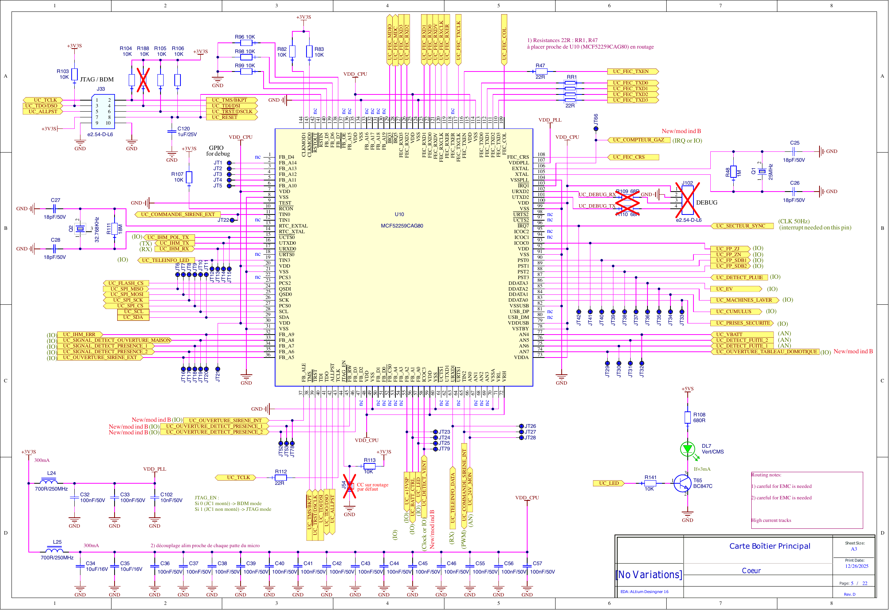
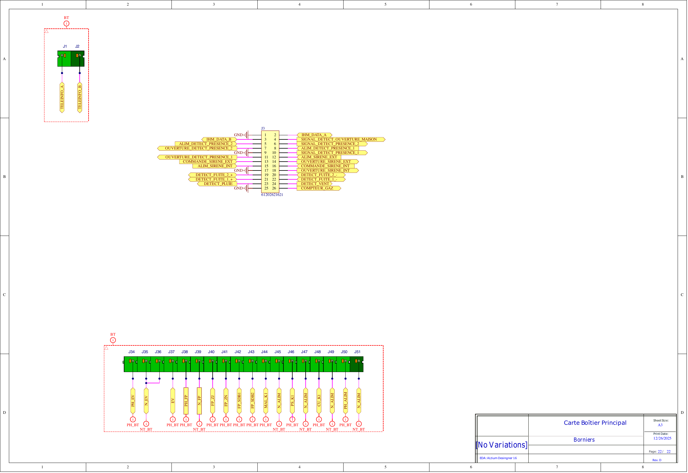

# Documentation Module SC944D

Bienvenue dans la documentation technique du module **SC944D** pour le projet Open Source **Essensys**.

Ce module est une carte électronique conçue pour [Insérer description brève si connue, ou laisser générique]. Cette documentation fournit tous les détails nécessaires pour comprendre l'architecture, fabriquer le hardware et développer le firmware.

## Aperçu du schéma

Voici un aperçu des pages clés du schéma électronique :

*Microcontrôleur*

*Connecteurs*

> [!TIP]
> Le schéma complet est disponible en téléchargement ou dans la section [Hardware](hardware.md).

## Sections

*   **[🏛️ Architecture](architecture.md)** : Vue d'ensemble du système et diagrammes blocs.
*   **[🔌 Hardware](hardware.md)** : Détails électroniques, routage et composants.
*   **[💾 Téléchargements](downloads.md)** : Fichiers sources, modèles 3D et fichiers de fabrication.
*   **[💻 Firmware](firmware.md)** : Guide de développement et mapping mémoire.
